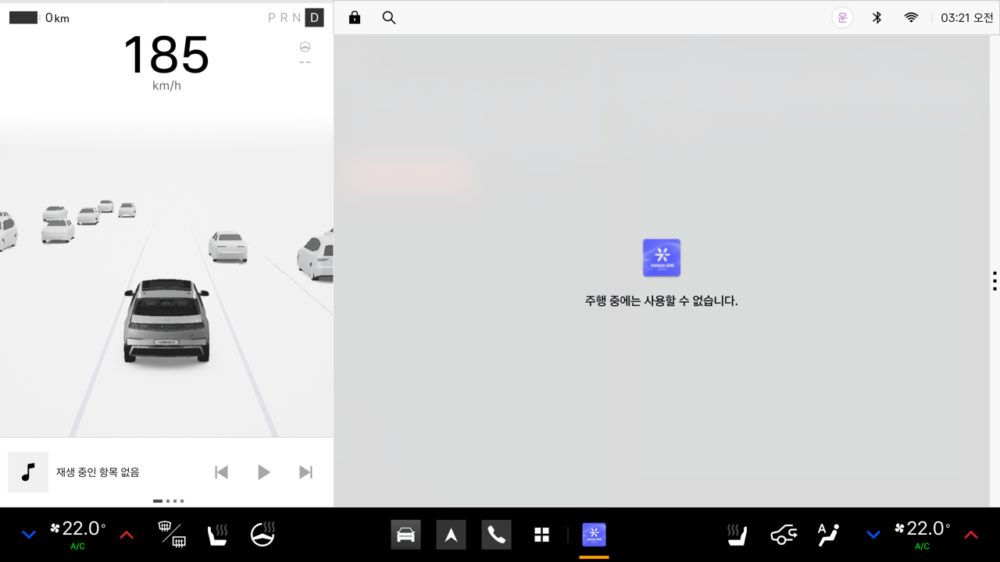
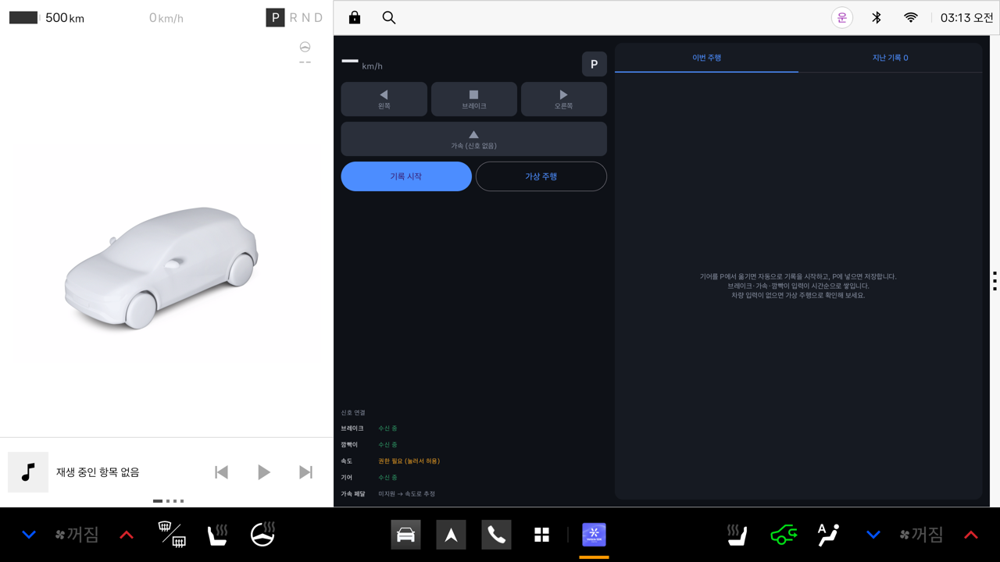
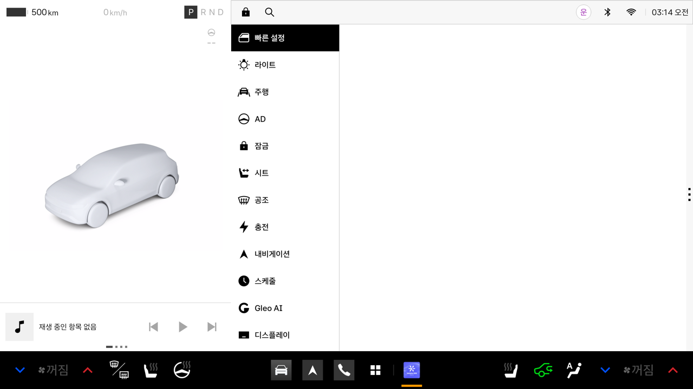
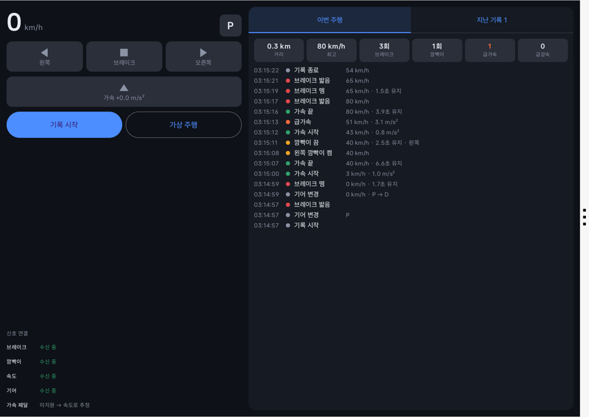
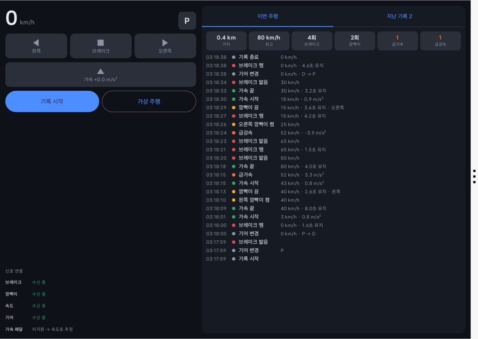
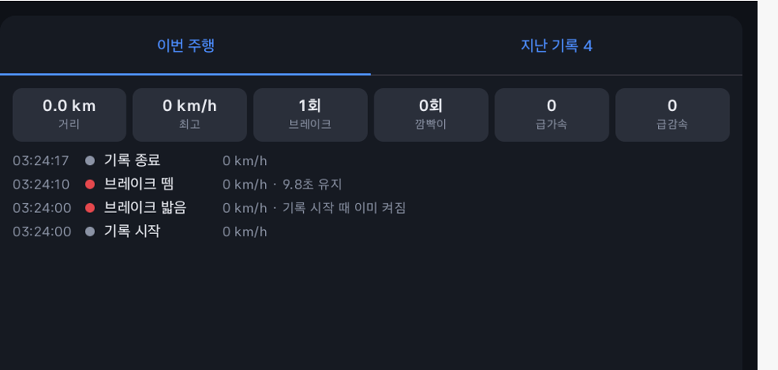

# 에뮬레이터 테스트 — 2026-11-12

## 환경

| 항목 | 값 |
|---|---|
| APK | `apk/세교동세얼간이_나의운전저장소_release.apk` v0.2.0 (versionCode 4), main `8c2a33d`, SHA256 일치 |
| 에뮬레이터 | Pleos Connect v2.1.0 시스템 이미지 (API 34, x86_64), Android Emulator 37.2.13, Cold boot, RAM 4 GB |
| Vehicle 서비스 | `ai.pleos.playground.service.vehicle` **2.3.22** (SDK 요구 2.3.13 이상 → 충족) |
| PC | i5-10300H, RAM 16 GB, GTX 1650 4 GB (Pleos 권장 최소 RTX 3060 6 GB보다 낮음), WHPX 가속 |
| 신호 입력 | Pleos Virtual Console (`adb forward tcp:8088 tcp:8088` → `http://127.0.0.1:8088/`) |

부팅 약 30초, 화면 끊김 없이 동작했습니다.

## 요약

| 우선 | 문제 | 상태 |
|---|---|---|
| **P0** | 실제 주행(D·속도 있음) 중 앱 화면이 "주행 중에는 사용할 수 없습니다"로 가려짐 | 재현됨 |
| P1 | 첫 실행 때 속도 권한 요청 창이 내비 화면 뒤에 가려져 안 보임 → 속도 "권한 필요" | 재현됨 |
| P1 | "권한 필요"를 누르면 앱 권한 화면이 아니라 차량 설정 첫 화면으로 감 | 재현됨 |
| P1 | CSV 내보내기를 눌러도 화면에 아무 변화 없음 (공유 창·토스트 둘 다 안 보임) | 재현됨 |
| P1 | 가상 주행 1회차가 급제동 순간(54 km/h)에 기록 종료로 끊김 | 2회 중 1회, 원인 미확인 |
| P2 | 실제 페달을 한 번 길게 밟았는데 급가속 7회·급감속 4회가 찍힘 | 확인 필요 |
| P2 | 이번 주행은 최신이 위, 지난 기록 상세는 오래된 것이 위 — 순서가 다름 | 확인됨 |

---

## 실기 체크리스트 결과

| # | 항목 | 결과 |
|---|---|---|
| 1 | 기어 D·주행 중 화면이 가려지지 않는가 | ❌ **가려짐** (아래 1번) |
| 2 | 가상 주행 → 급가속·급감속이 각 1회만 찍히는가 | ⚠️ 2회차는 각 1회로 정상, 1회차는 급감속 직전에 끊김 (아래 5번) |
| 3 | 신호 연결이 "수신 중"으로 바뀌고 Virtual Console 조작이 반영되는가 | ✅ 브레이크·깜빡이·속도·기어 모두 "수신 중". 가속 페달은 "미지원 → 속도로 추정"(API 34라 예상대로) |
| 4 | 같은 APK를 `adb install -r`로 덮어 설치되는가 | ✅ 성공, 기존 기록 4건 유지 |
| 5 | CSV 내보내기를 눌렀을 때 무언가 일어나는가 | ❌ 아무 변화 없음 (아래 4번) |
| 7 | 브레이크 밟은 채 기록 시작 → 떼기 → 횟수·시간이 맞는가 | ✅ "기록 시작 때 이미 켜짐"으로 1회, 유지 시간은 기록 시작부터 계산 |
| — | 기어 기준 자동 기록 (PR #4) | ✅ 실제 신호 P→D에서 시작, D→P에서 종료·저장 |
| — | Vehicle 서비스 최소 버전 | ✅ 2.3.22 |

---

## 문제 상세

### 1. [P0] 주행 중 앱 화면 차단

- 재현: Virtual Console에서 기어 D → ACCEL 누르기
- 결과: 앱 영역 전체가 "주행 중에는 사용할 수 없습니다"로 덮임. 정차 후에는 다시 보임
- 매니페스트에 `distractionOptimized=true`가 있는데도 막힘. Pleos 쪽 주행 중 허용(DO) 앱 정책(화이트리스트 등)을 확인해야 함
- 참고: 가상 주행은 앱 안에서 신호를 만들기 때문에 이 차단이 일어나지 않음. 시연을 가상 주행으로만 하면 안 보이는 문제

### 2. [P1] 첫 실행 권한 창이 가려짐

- 설치 후 첫 실행 때 속도 권한 요청 창이 떴지만(시스템 기록상 실행됨) 내비 화면 뒤에 가려져 보이지 않음
- 앱을 다시 앞으로 불러오면 권한 창은 사라지고 속도만 "권한 필요 (눌러서 허용)" 상태

### 3. [P1] "권한 필요"가 차량 설정 첫 화면으로 감

- 속도 "권한 필요"를 누르면 앱 권한 화면이 아니라 차량 설정의 첫 화면(빠른 설정)이 열림. 여기서 앱 권한을 찾아가는 경로가 없음
- 테스트를 이어가려고 `adb shell pm grant --user 10 com.hhgaq.drivelog android.car.permission.CAR_SPEED`로 권한을 줌 → 이후 속도 "수신 중"

### 4. [P1] CSV 내보내기 반응 없음

- 지난 기록 상세 → "CSV 내보내기" → 공유 창도 토스트도 안 보임 (0.6초·1.6초 뒤 화면 캡처 모두 변화 없음)
- 에뮬레이터에 `text/plain` 공유를 받는 앱이 없어서 파일 저장 경로(`exportCsvFile` + 토스트)로 가야 하는데, 시스템 로그에 토스트 기록이 없음. 차량 UI가 토스트를 막는 것으로 보임
- release 빌드라 파일이 실제로 저장됐는지는 확인하지 못함

### 5. [P1] 가상 주행 1회차가 중간에 끊김

- 1회차: 03:14:57 시작 → 03:15:22 "기록 종료 54 km/h". 급제동(65→25 km/h) 시작 직후 끊겨서 급감속·우회전·정차가 없음 (급감속 0)
- 2회차: 시나리오 끝까지 정상 (브레이크 4, 깜빡이 2, 급가속 1, 급감속 1, P에서 종료)
- 1회차 동안 화면 터치·앱 재시작·크래시 기록 없음. `stopTrip()`을 부르는 곳은 화면 버튼 두 개와 시나리오 종료뿐이라 원인을 특정하지 못함
- 1회차는 앱을 강제 종료 후 다시 켠 직후 첫 가상 주행이었음

| 1회차 (끊김) | 2회차 (정상) |
|---|---|
|  |  |

### 6. [P2] 실제 신호에서 급가속·급감속이 여러 번 찍힘

- Virtual Console에서 ACCEL을 약 1분간 계속 누른 뒤 BRAKE를 계속 누름 → 급가속 7회, 급감속 4회
- 콘솔의 가속 곡선이 출렁여서(변속 등) 재무장(armed) 조건을 반복 통과했을 수 있음. README의 "한 구간에 한 번만 기록"과 다르게 보일 수 있어 기준 확인 필요
- 최고 속도 240 km/h, 거리 2.4 km로 기록됨

### 7. [P2] 이벤트 순서가 화면마다 다름

- "이번 주행"은 최신 이벤트가 위, "지난 기록" 상세는 오래된 이벤트가 위

---

## 정상 동작 확인

- 설치·실행·재설치: 크래시 없음
- 신호 연결: 브레이크·깜빡이·속도·기어 "수신 중"
- 브레이크를 밟은 채 기록 시작: "기록 시작 때 이미 켜짐"

